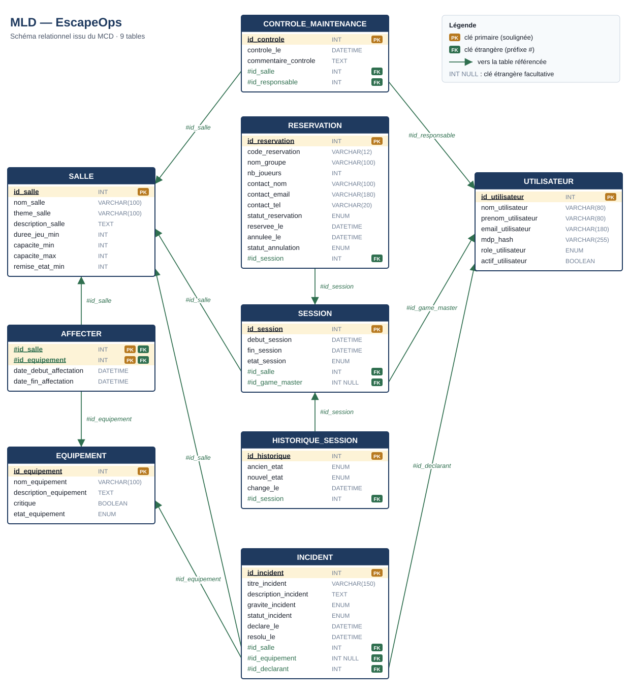

# MLD — EscapeOps

Modèle logique relationnel obtenu à partir du [MCD](MCD.svg) par les règles de passage Merise.

**Notation :** <ins>souligné</ins> = clé primaire · `#` = clé étrangère · `(NULL)` = clé étrangère facultative.

Le schéma ci-dessus ([MLD.svg](MLD.svg)) montre chaque table avec ses colonnes et leur type prévu en MySQL ; chaque flèche part d'une clé étrangère et pointe vers la table référencée.

## 1. Règles de passage appliquées

| Cas dans le MCD | Transformation | Où dans EscapeOps |
|---|---|---|
| Entité | devient une relation ; son identifiant devient la clé primaire | les 8 entités |
| Association **(1,1) – (0,n)** | l'identifiant du côté (0,n) migre comme **clé étrangère obligatoire** dans la relation du côté (1,1) | ACCUEILLIR, CONCERNER, TRACER, CONTROLER, EFFECTUER, SURVENIR, DECLARER |
| Association **(0,1) – (0,n)** | l'identifiant du côté (0,n) migre comme **clé étrangère facultative** (NULL autorisé) du côté (0,1) | ANIMER, IMPLIQUER |
| Association **(0,n) – (0,n)** | devient une relation dont la clé primaire est la **concaténation** des deux identifiants, plus les propriétés portées | AFFECTER |

Quand une même relation référence UTILISATEUR, la clé étrangère est **renommée selon son rôle** (`id_game_master`, `id_responsable`, `id_declarant`) pour rester lisible ; elle référence toujours `UTILISATEUR(id_utilisateur)`.

## 2. Schéma relationnel

**UTILISATEUR** (<ins>id_utilisateur</ins>, nom_utilisateur, prenom_utilisateur, email_utilisateur, mdp_hash, role_utilisateur, actif_utilisateur)

**SALLE** (<ins>id_salle</ins>, nom_salle, theme_salle, description_salle, duree_jeu_min, capacite_min, capacite_max, remise_etat_min)

**SESSION** (<ins>id_session</ins>, debut_session, fin_session, etat_session, #id_salle, #id_game_master (NULL))

**RESERVATION** (<ins>id_reservation</ins>, code_reservation, nom_groupe, nb_joueurs, contact_nom, contact_email, contact_tel, statut_reservation, reservee_le, annulee_le, statut_annulation, #id_session)

**HISTORIQUE_SESSION** (<ins>id_historique</ins>, ancien_etat, nouvel_etat, change_le, #id_session)

**EQUIPEMENT** (<ins>id_equipement</ins>, nom_equipement, description_equipement, critique, etat_equipement)

**AFFECTER** (<ins>#id_salle, #id_equipement</ins>, date_debut_affectation, date_fin_affectation)

**INCIDENT** (<ins>id_incident</ins>, titre_incident, description_incident, gravite_incident, statut_incident, declare_le, resolu_le, #id_salle, #id_equipement (NULL), #id_declarant)

**CONTROLE_MAINTENANCE** (<ins>id_controle</ins>, controle_le, commentaire_controle, #id_salle, #id_responsable)

**9 relations** : 8 issues des entités + 1 issue de l'association N–N.

## 3. Clés étrangères

| Relation | Clé étrangère | Référence | NULL ? | Issue de | Suppression du parent |
|---|---|---|---|---|---|
| SESSION | id_salle | SALLE(id_salle) | non | ACCUEILLIR | refusée (RESTRICT) |
| SESSION | id_game_master | UTILISATEUR(id_utilisateur) | **oui** | ANIMER | refusée (RESTRICT) : la colonne figure dans le CHECK E5, et MariaDB/MySQL y interdisent toute action référentielle (SET NULL, CASCADE) |
| RESERVATION | id_session | SESSION(id_session) | non | CONCERNER | refusée (RESTRICT) |
| HISTORIQUE_SESSION | id_session | SESSION(id_session) | non | TRACER | cascade (l'historique suit la session) |
| AFFECTER | id_salle | SALLE(id_salle) | non | AFFECTER | refusée (RESTRICT) |
| AFFECTER | id_equipement | EQUIPEMENT(id_equipement) | non | AFFECTER | refusée (RESTRICT) |
| INCIDENT | id_salle | SALLE(id_salle) | non | SURVENIR | refusée (RESTRICT) |
| INCIDENT | id_equipement | EQUIPEMENT(id_equipement) | **oui** | IMPLIQUER | refusée (RESTRICT) |
| INCIDENT | id_declarant | UTILISATEUR(id_utilisateur) | non | DECLARER | refusée (RESTRICT) |
| CONTROLE_MAINTENANCE | id_salle | SALLE(id_salle) | non | CONTROLER | refusée (RESTRICT) |
| CONTROLE_MAINTENANCE | id_responsable | UTILISATEUR(id_utilisateur) | non | EFFECTUER | refusée (RESTRICT) |

En exploitation, on **désactive** un utilisateur (`actif_utilisateur = faux`) ou on **annule** une session plutôt que de supprimer : la traçabilité est conservée.

## 4. Contraintes d'intégrité

### Exprimables dans le schéma SQL

| Relation | Contrainte | Type SQL |
|---|---|---|
| UTILISATEUR | `email_utilisateur` unique | UNIQUE |
| SALLE | `nom_salle` unique | UNIQUE |
| SALLE | `duree_jeu_min > 0`, `capacite_min >= 1`, `capacite_max >= capacite_min`, `remise_etat_min >= 0` | CHECK |
| SESSION | `fin_session > debut_session` (invariant du socle) | CHECK |
| SESSION | une session `EN_COURS` ou `TERMINEE` a un game master : `etat_session NOT IN ('EN_COURS','TERMINEE') OR id_game_master IS NOT NULL` (**E5**, double protection du contrôle applicatif) | CHECK |
| RESERVATION | `code_reservation` unique ; `nb_joueurs > 0` | UNIQUE, CHECK |
| RESERVATION | `annulee_le` et `statut_annulation` renseignés **si et seulement si** `statut_reservation = 'ANNULEE'` (**E7**) | CHECK |
| AFFECTER | `date_fin_affectation IS NULL OR date_fin_affectation > date_debut_affectation` | CHECK |
| INCIDENT | `resolu_le` renseigné si et seulement si `statut_incident = 'RESOLU'` | CHECK |
| colonnes « L » | valeurs limitées à la liste du dictionnaire | ENUM |

Les `CHECK` sont appliqués par MySQL ≥ 8.0.16 et MariaDB ≥ 10.2.1.

### Contrôlées par l'application (services PHP)

Ces règles portent sur plusieurs lignes ou plusieurs relations : un `CHECK` ne peut pas les exprimer.

| Règle | Contrôle | Où |
|---|---|---|
| **E5** — un game master ne se dédouble pas | refuser une affectation si une autre session du même `id_game_master` vérifie `debut_session < fin_autre AND fin_session > debut_autre` (les créneaux jointifs sont acceptés) | service des sessions (HTML et API) |
| **E5** — démarrage | refuser le passage à `EN_COURS` sans `id_game_master` (doublé par le CHECK ci-dessus) | service des sessions |
| `id_game_master` | doit désigner un utilisateur de rôle `GAME_MASTER` et actif | service des sessions |
| `id_responsable` | doit désigner un utilisateur de rôle `RESPONSABLE` | service de maintenance |
| **E7** — classement | `SANS_FRAIS` si `debut_session - annulee_le >= 24 h`, sinon `TARDIVE` ; calculé une seule fois, à l'annulation | service des réservations |
| **E9** — badge | `CONTROLE_A_PREVOIR` si le nombre de sessions `TERMINEE` de la salle postérieures au dernier `controle_le` est ≥ 10 ; les sessions `ANNULEE` sont ignorées | procédure stockée « bilan par salle », appelée depuis le repository |
| Une réservation confirmée par session | au plus une RESERVATION `CONFIRMEE` par session (une session = un groupe privatisé) | service des réservations, dans une transaction |
| Invariants du socle | impossible de réserver une session passée, `ANNULEE` ou déjà confirmée | service des réservations |
| Taille du groupe | `capacite_min <= nb_joueurs <= capacite_max` de la salle (prêt pour E3) | service des réservations |
| Affectation en cours | un équipement a au plus une ligne AFFECTER avec `date_fin_affectation` vide | service des équipements |
| Cohérence incident | si `id_equipement` est renseigné, l'équipement est affecté à `id_salle` | service des incidents |

## 5. Objets SQL avancés prévus sur ce modèle

| Objet | S'appuie sur | Rôle |
|---|---|---|
| Trigger `AFTER UPDATE` sur SESSION | SESSION → HISTORIQUE_SESSION | insère une ligne quand `etat_session` change |
| Procédure « bilan par salle » | SALLE, SESSION, CONTROLE_MAINTENANCE | compte les sessions terminées depuis le dernier contrôle (**E9**) |
| Vue planning | SESSION, SALLE, UTILISATEUR, RESERVATION | sessions à venir avec salle, game master et groupe |
| Vue tableau de bord | SESSION, INCIDENT, SALLE | prochaines sessions, incidents ouverts, disponibilité |

Le détail SQL de ces objets relève du livrable [2-base-de-donnees](../../2-base-de-donnees/README.md).
