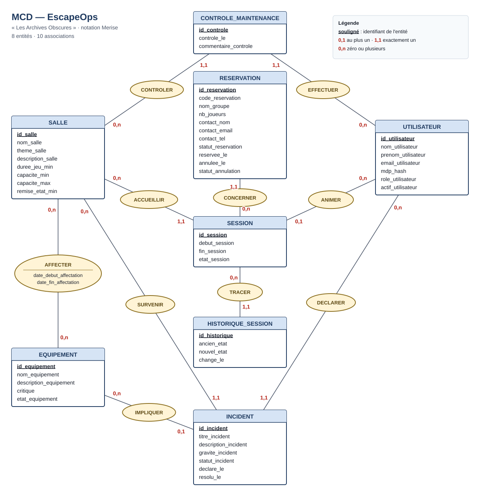

# Modélisation des données — EscapeOps (C3)

Méthode **Merise** : on part du dictionnaire de données, on construit le **MCD** (niveau conceptuel, sans clés étrangères), puis on le transforme en **MLD** (schéma relationnel) par les règles de passage.

| Fichier | Contenu |
|---|---|
| [MCD.svg](MCD.svg) | Modèle conceptuel : entités, associations, cardinalités |
| [README.md](README.md) (ce fichier) | Dictionnaire de données, lecture des cardinalités, choix de modélisation |
| [MLD.md](MLD.md) | Règles de passage, schéma relationnel, contraintes d'intégrité |

## 1. Dictionnaire de données

Chaque propriété n'apparaît qu'une seule fois dans le modèle (règle Merise). Types : **E** entier, **T(n)** texte de n caractères, **TL** texte long, **DH** date-heure, **B** booléen, **L** liste de valeurs.

### UTILISATEUR

| Code | Signification | Type | Contraintes / valeurs |
|---|---|---|---|
| **id_utilisateur** | identifiant de l'utilisateur | E | identifiant |
| nom_utilisateur | nom de famille | T(80) | obligatoire |
| prenom_utilisateur | prénom | T(80) | obligatoire |
| email_utilisateur | adresse de connexion | T(180) | obligatoire, unique |
| mdp_hash | mot de passe haché (`password_hash`) | T(255) | obligatoire, jamais en clair |
| role_utilisateur | rôle applicatif | L | `ADMIN`, `RESPONSABLE`, `GAME_MASTER` |
| actif_utilisateur | compte utilisable | B | vrai par défaut |

### SALLE

| Code | Signification | Type | Contraintes / valeurs |
|---|---|---|---|
| **id_salle** | identifiant de la salle | E | identifiant |
| nom_salle | nom commercial (« Le Cabinet des Ombres ») | T(100) | obligatoire, unique |
| theme_salle | thème affiché sur la vitrine | T(100) | obligatoire |
| description_salle | texte de présentation | TL | facultatif |
| duree_jeu_min | durée d'une partie en minutes | E | > 0 |
| capacite_min | taille minimale du groupe | E | ≥ 1 |
| capacite_max | taille maximale du groupe | E | ≥ capacite_min |
| remise_etat_min | temps de remise en état entre deux sessions, en minutes | E | ≥ 0 (prêt pour l'extension E4) |

### SESSION

| Code | Signification | Type | Contraintes / valeurs |
|---|---|---|---|
| **id_session** | identifiant de la session | E | identifiant |
| debut_session | date et heure de début | DH | obligatoire |
| fin_session | date et heure de fin | DH | obligatoire, > debut_session |
| etat_session | état d'exploitation | L | `PREVUE`, `PRETE`, `EN_COURS`, `TERMINEE`, `ANNULEE` |

### RESERVATION

| Code | Signification | Type | Contraintes / valeurs |
|---|---|---|---|
| **id_reservation** | identifiant de la réservation | E | identifiant |
| code_reservation | code remis au client sans compte pour consulter / annuler | T(12) | obligatoire, unique |
| nom_groupe | nom du groupe de joueurs | T(100) | obligatoire |
| nb_joueurs | nombre de joueurs du groupe | E | > 0 |
| contact_nom | nom de la personne à contacter | T(100) | obligatoire |
| contact_email | courriel de contact (fictif) | T(180) | obligatoire |
| contact_tel | téléphone de contact (fictif) | T(20) | facultatif |
| statut_reservation | statut | L | `CONFIRMEE`, `ANNULEE` |
| reservee_le | date et heure de la réservation | DH | obligatoire |
| annulee_le | date et heure de l'annulation (**E7**) | DH | renseigné si ANNULEE |
| statut_annulation | classement de l'annulation (**E7**) | L | `SANS_FRAIS`, `TARDIVE` ; renseigné si ANNULEE |

### EQUIPEMENT

| Code | Signification | Type | Contraintes / valeurs |
|---|---|---|---|
| **id_equipement** | identifiant de l'équipement | E | identifiant |
| nom_equipement | nom (« mécanisme de la porte ») | T(100) | obligatoire |
| description_equipement | description | TL | facultatif |
| critique | la panne bloque l'exploitation de la salle | B | faux par défaut |
| etat_equipement | état | L | `OPERATIONNEL`, `EN_PANNE`, `HORS_SERVICE` |

### CONTROLE_MAINTENANCE (E9)

| Code | Signification | Type | Contraintes / valeurs |
|---|---|---|---|
| **id_controle** | identifiant du contrôle | E | identifiant |
| controle_le | date et heure du contrôle | DH | obligatoire |
| commentaire_controle | observations | TL | facultatif |

### HISTORIQUE_SESSION (alimentée par le trigger)

| Code | Signification | Type | Contraintes / valeurs |
|---|---|---|---|
| **id_historique** | identifiant de la ligne d'historique | E | identifiant |
| ancien_etat | état avant la transition | L | mêmes valeurs que etat_session |
| nouvel_etat | état après la transition | L | mêmes valeurs que etat_session |
| change_le | date et heure de la transition | DH | obligatoire |

### INCIDENT

| Code | Signification | Type | Contraintes / valeurs |
|---|---|---|---|
| **id_incident** | identifiant de l'incident | E | identifiant |
| titre_incident | résumé | T(150) | obligatoire |
| description_incident | détail | TL | facultatif |
| gravite_incident | gravité | L | `MINEUR`, `BLOQUANT` |
| statut_incident | statut | L | `OUVERT`, `RESOLU` |
| declare_le | date et heure de déclaration | DH | obligatoire |
| resolu_le | date et heure de résolution | DH | renseigné si RESOLU |

### Propriétés portées par l'association AFFECTER

| Code | Signification | Type | Contraintes / valeurs |
|---|---|---|---|
| date_debut_affectation | date d'installation de l'équipement dans la salle | DH | obligatoire |
| date_fin_affectation | date de retrait | DH | vide tant que l'équipement est en place |

## 2. Lecture des associations et cardinalités

| Association | Entité A (card.) | Entité B (card.) | Se lit |
|---|---|---|---|
| ACCUEILLIR | SALLE (0,n) | SESSION (1,1) | Une salle accueille zéro ou plusieurs sessions ; une session a lieu dans une et une seule salle. |
| ANIMER | UTILISATEUR (0,n) | SESSION (0,1) | Un utilisateur (game master) anime zéro ou plusieurs sessions ; une session est animée par **au plus un** game master : elle peut être planifiée sans lui (**E5**). |
| CONCERNER | SESSION (0,n) | RESERVATION (1,1) | Une session reçoit zéro ou plusieurs réservations (annulées comprises) ; une réservation concerne une et une seule session. |
| TRACER | SESSION (0,n) | HISTORIQUE_SESSION (1,1) | Une session a zéro ou plusieurs lignes d'historique ; chaque ligne trace une seule session. |
| CONTROLER | SALLE (0,n) | CONTROLE_MAINTENANCE (1,1) | Une salle subit zéro ou plusieurs contrôles ; un contrôle porte sur une seule salle (**E9**). |
| EFFECTUER | UTILISATEUR (0,n) | CONTROLE_MAINTENANCE (1,1) | Un utilisateur (responsable) effectue zéro ou plusieurs contrôles ; un contrôle a un seul auteur. |
| AFFECTER | SALLE (0,n) | EQUIPEMENT (0,n) | Une salle reçoit zéro ou plusieurs équipements ; un équipement peut être affecté à plusieurs salles au fil du temps. **Relation N–N** porteuse des dates d'affectation. |
| SURVENIR | SALLE (0,n) | INCIDENT (1,1) | Une salle connaît zéro ou plusieurs incidents ; un incident survient dans une seule salle. |
| IMPLIQUER | EQUIPEMENT (0,n) | INCIDENT (0,1) | Un équipement est impliqué dans zéro ou plusieurs incidents ; un incident implique au plus un équipement (une fuite d'eau n'en implique aucun). |
| DECLARER | UTILISATEUR (0,n) | INCIDENT (1,1) | Un utilisateur déclare zéro ou plusieurs incidents ; un incident est déclaré par un seul utilisateur. |

## 3. Choix de modélisation (à défendre à l'oral)

1. **Une seule entité UTILISATEUR avec un rôle**, plutôt qu'une entité par profil. Les trois rôles partagent les mêmes propriétés (connexion) ; la « fiche game master » est un utilisateur de rôle `GAME_MASTER`. Que seul un game master puisse ANIMER, ou seul un responsable EFFECTUER un contrôle, est une contrainte vérifiée par l'application.
2. **Le client public n'a pas de compte.** Il n'est pas modélisé comme entité : ses coordonnées (fictives) sont des propriétés de la RESERVATION, et le `code_reservation` lui permet de retrouver sa réservation et son statut d'annulation (**E7**). Créer une entité CLIENT n'apporterait rien tant qu'aucun client ne se connecte.
3. **ANIMER en (0,1) côté SESSION** plutôt qu'une association N–N session ↔ intervenant : une session n'a qu'un game master, ce qui garde la détection de conflit **E5** simple (une seule table à interroger).
4. **La relation N–N utile est AFFECTER (salle ↔ équipement).** Certains équipements circulent entre salles (talkies, lampes UV) ; les dates portées par l'association indiquent où se trouve l'équipement et depuis quand.
5. **Pas de compteur stocké pour E9.** Le nombre de sessions `TERMINEE` depuis le dernier contrôle est une donnée **calculée** (procédure stockée « bilan par salle ») ; la stocker créerait une redondance à maintenir.
6. **`statut_annulation` est stocké (E7)** bien qu'il se déduise de `annulee_le` et `debut_session` : si la session est déplacée après l'annulation, le classement doit rester celui décidé au moment de l'annulation (exigence « statut conservé »).
7. **`fin_session` est stockée** plutôt que calculée avec `duree_jeu_min` : la règle E5 compare des intervalles `[début, fin[` et une session peut exceptionnellement durer plus ou moins que la durée standard.
8. **HISTORIQUE_SESSION** est une entité à part entière, alimentée par le trigger SQL à chaque changement d'`etat_session` (clause SQL avancé), sans règle métier supplémentaire.
9. **Pas d'association directe INCIDENT ↔ SESSION** : elle formerait un cycle redondant avec SALLE et n'est utile qu'à la règle E6, non retenue. Elle pourra être ajoutée lors d'une évolution.

**Extensions préparées :** `capacite_min` / `capacite_max` (E3) et `remise_etat_min` (E4) sont déjà dans SALLE, car la vitrine les affiche de toute façon. La checklist E10 n'est pas modélisée : elle le sera seulement si l'extension est réalisée.
